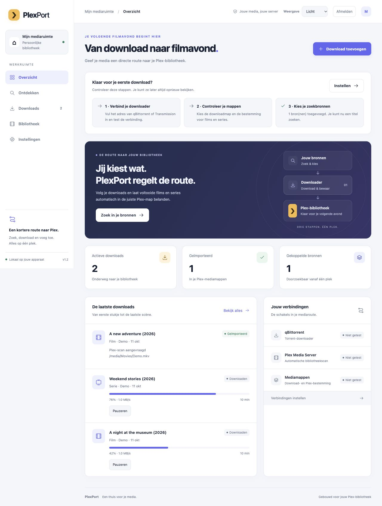
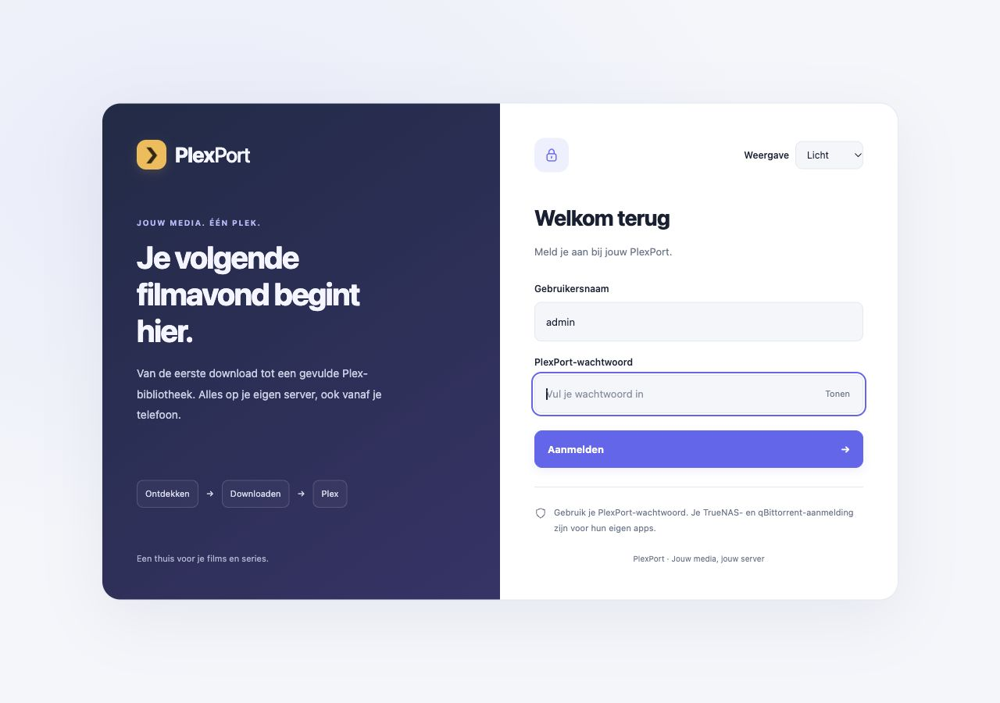

# PlexPort

### From download to your Plex library, in one place.

Find a movie or TV show, choose a version and follow the download.
PlexPort puts completed videos in the right media folder.

[Get started](#get-started) · [How to use it](docs/GEBRUIKEN.md) · [Need help?](docs/HULP.md) · [Download Android app](https://github.com/Tufein/PlexPort/raw/refs/heads/main/android/dist/PlexPort-1.2.0.apk)

*Example screen with demo titles. Your search results come from the sources you add. The app currently uses Dutch labels; the guides explain which buttons to choose.*

## What can you do with it?

- **Find and choose.** Filter by Full HD, 4K, file size and the number of people sharing a file.
- **Follow downloads.** See what is happening, stop or resume a download and understand why a task is waiting. Remove unwanted tasks, with an optional choice to delete downloaded files.
- **Organize movies and shows.** Completed videos and subtitles go to your chosen Plex folders.
- **Catch problems early.** Check connections and folders with one button. See available space before starting a download.
- **Use your phone.** The Android app opens the same PlexPort server and the same downloads.
- **Choose your look.** A modern layout with light, dark or your device's setting.
- **Sign in easily.** A dedicated welcome screen on the website and Android app, with a password visibility option.

See the new website sign-in screen

## What do you need?

**Plex** to watch your movies and shows, **qBittorrent or Transmission** to download files, and a computer or **NAS** — a storage device on your home network — that can keep PlexPort running.

PlexPort connects these parts. It does not replace Plex or your downloader. You choose your own search sources, and there is no PlexPort subscription.

## Get started

Choose the option that matches your setup:

| I want to use PlexPort on… | Start here |
|---|---|
| **TrueNAS 25.10** | [Install on TrueNAS](docs/START-TRUENAS.md) |
| **Another NAS or a computer with Docker** | [Install on another NAS](INSTALLATIE-NAS.md) |
| **My Mac** | [Start on a Mac](docs/START-MAC.md) |
| **My Android phone** | [Install Android app](docs/START-ANDROID.md) — PlexPort must already be running on your NAS or computer |

[Download the app files as a ZIP](https://github.com/Tufein/PlexPort/archive/refs/heads/main.zip) and extract them first. **PlexPort is not yet a one-click app in the TrueNAS app catalog.** Initial setup needs your server address and folder settings; the TrueNAS guide walks you through them.

## Your first download in three steps

1. **Set up:** open **Instellingen (Settings)**, enter your downloader and folders, then click **Alles controleren (Check everything)**. Add a search source if you want to search inside the app.
2. **Choose:** open **Ontdekken (Discover)**, search for a title and use the filters to find a suitable version. Click **Kiezen (Choose)** and check the title and destination.
3. **Follow:** click **Download starten (Start download)**. Track progress under **Downloads**, with posters to recognize your titles. Once the video has been placed, the task appears under **Bibliotheek (Library)**.

You can also use **Download toevoegen (Add download)** for your own link or torrent file. Only download and share media you have permission to use.

## Good to know

- PlexPort and your downloader must see **the same download files**. This is the most important setting.
- Plex needs read access to the movie and TV folders. Entering a Plex server address alone is not enough.
- Original downloads stay in place for sharing. If files need to be copied, they may use extra space.
- The space check is a snapshot. The file size of a manually added link is not known in advance.
- **Bibliotheek (Library)** shows files imported by PlexPort, not your entire Plex collection.
- Only downloads added through PlexPort are processed automatically. The app does not extract ZIP or RAR archives.

## Something isn't working

[Read the troubleshooting guide](docs/HULP.md). If your problem is not covered, [report it](https://github.com/Tufein/PlexPort/issues/new?template=probleem.yml) and describe what you see. Do not share passwords or private access details.

Have an idea? [Suggest a feature](https://github.com/Tufein/PlexPort/issues/new?template=idee.yml).

For administrators and developers

[Technical guide](docs/TECHNISCH.md) · [TrueNAS folder setup](INSTALLATIE-TRUENAS.md) · [Build Android app](android/README.md) · [Contribute](CONTRIBUTING.md) · [What's new](CHANGELOG.md) · [Roadmap](ROADMAP.md)

