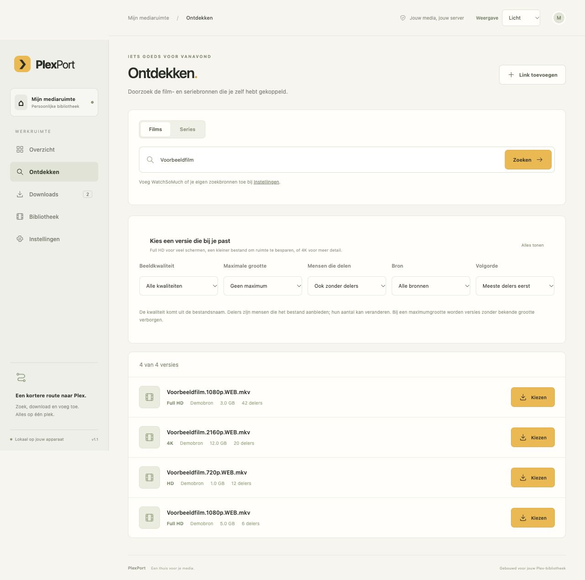

# PlexPort

### Van een download naar je Plex-bibliotheek, op één plek.

Zoek een film of serie, kies een versie en volg de download.
PlexPort zet de voltooide video's in de juiste mediamap.

[Aan de slag](#aan-de-slag) · [Zo gebruik je het](docs/GEBRUIKEN.md) · [Hulp nodig?](docs/HULP.md) · [Android downloaden](https://github.com/Tufein/PlexPort/raw/refs/heads/main/android/dist/PlexPort-1.0.0.apk)

*Voorbeeldscherm met demonstratietitels. Je eigen zoekresultaten komen uit de bronnen die je toevoegt.*

## Wat kun je ermee?

- **Zoeken en kiezen.** Filter op Full HD, 4K, bestandsgrootte en het aantal mensen dat een bestand deelt.
- **Downloads volgen.** Zie wat er gebeurt, pauzeer een download en herken waarom een taak wacht.
- **Films en series ordenen.** Voltooide video's en ondertitels gaan naar je ingestelde Plex-mappen.
- **Problemen eerder zien.** Controleer de verbindingen en mappen met één knop. Voor een download zie je de beschikbare ruimte.
- **Op je telefoon gebruiken.** De Android-app opent dezelfde PlexPort-server met dezelfde downloads.
- **Je eigen uiterlijk kiezen.** Licht, donker of de instelling van je apparaat.

## Wat heb je nodig?

**Plex**, om je films en series te bekijken. **qBittorrent of Transmission**, om bestanden te downloaden. En een computer of **NAS** — je opslagapparaat op het thuisnetwerk — waarop PlexPort kan blijven draaien.

PlexPort verbindt die onderdelen. Het vervangt Plex en je downloader niet. Je kiest zelf je zoekbronnen; je hoeft geen abonnement op PlexPort af te sluiten.

## Aan de slag

Kies de rij die bij jouw situatie past:

| Ik wil PlexPort gebruiken op… | Begin hier |
|---|---|
| **TrueNAS 25.10** | [Installeren op TrueNAS](docs/START-TRUENAS.md) |
| **Een andere NAS of een computer met Docker** | [Installeren op een andere NAS](INSTALLATIE-NAS.md) |
| **Mijn Mac** | [Starten op een Mac](docs/START-MAC.md) |
| **Mijn Android-telefoon** | [Android installeren](docs/START-ANDROID.md) — PlexPort moet al op je NAS of computer draaien |

[Download de appbestanden als ZIP](https://github.com/Tufein/PlexPort/archive/refs/heads/main.zip). Pak het bestand eerst uit. **PlexPort is nog geen app die je met één klik uit de TrueNAS-appwinkel installeert.** De eerste installatie vraagt eenmalig om je serveradres en mapinstellingen; de TrueNAS-handleiding helpt je daarbij.

## Je eerste download in drie stappen

1. **Instellen:** open PlexPort → **Instellingen**, vul je downloader en mappen in en klik **Alles controleren**. Voeg een zoekbron toe als je in de app wilt zoeken.
2. **Kiezen:** ga naar **Ontdekken**, zoek een titel en gebruik de filters om een geschikte versie te vinden. Klik **Kiezen** en controleer de titel en bestemming.
3. **Volgen:** klik **Download starten**. Onder **Downloads** zie je de voortgang. Zodra de video is geplaatst, verschijnt de taak in **Bibliotheek**.

Je kunt ook meteen **Download toevoegen** gebruiken voor een eigen link of torrentbestand. Download alleen media die je mag downloaden en delen.

## Goed om te weten

- De downloadmap moet voor PlexPort en je downloader naar **dezelfde bestanden** verwijzen. Dit is de belangrijkste instelling.
- Plex moet de ingestelde film- en seriemappen kunnen lezen. Een Plex-adres alleen is daarvoor niet genoeg.
- Downloads blijven staan om ze te kunnen delen. Als kopiëren nodig is, kan dat extra ruimte kosten.
- De ruimtecontrole is een momentopname. Voor een eigen link is de bestandsgrootte nog onbekend.
- **Bibliotheek** toont wat PlexPort heeft geplaatst. Dat is niet je volledige Plex-verzameling.
- Alleen downloads die je in PlexPort toevoegt worden automatisch verwerkt. De app pakt geen ZIP- of RAR-bestanden uit.

## Er gaat iets mis

[Open de hulp bij veelvoorkomende problemen](docs/HULP.md). Staat jouw probleem er niet bij? [Meld een probleem](https://github.com/Tufein/PlexPort/issues/new?template=probleem.yml) en vertel wat je ziet. Deel geen wachtwoorden of persoonlijke toegangsgegevens.

Een idee voor een verbetering? [Stel een functie voor](https://github.com/Tufein/PlexPort/issues/new?template=idee.yml).

Voor beheerders en ontwikkelaars

[Technische uitleg](docs/TECHNISCH.md) · [TrueNAS-mapinstellingen](INSTALLATIE-TRUENAS.md) · [Android bouwen](android/README.md) · [Meewerken](CONTRIBUTING.md) · [Nieuwe functies](CHANGELOG.md) · [Toekomstplannen](ROADMAP.md)

